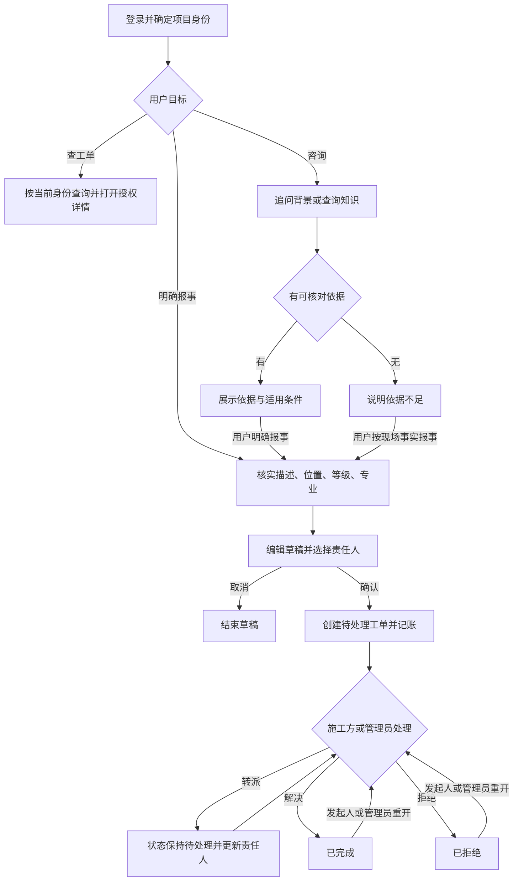
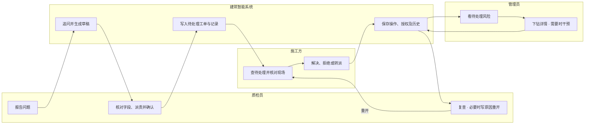
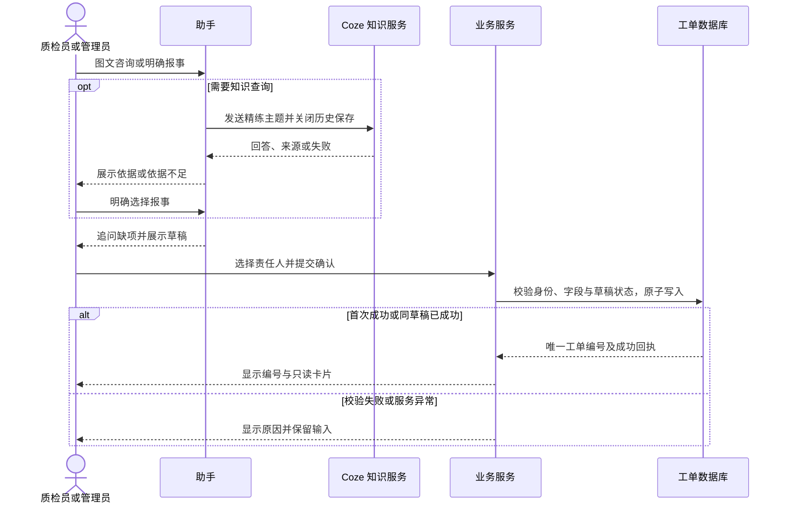
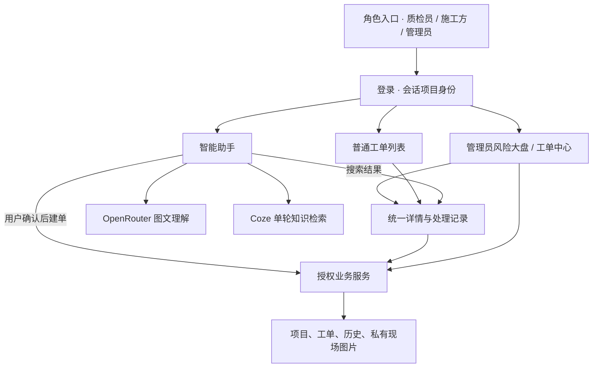
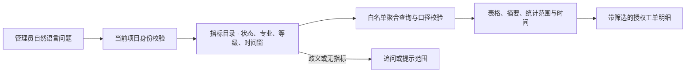

# 建筑智能管理系统 PRD

| 项目 | 内容 |
| --- | --- |
| 文档版本 | v1.0 评审稿 · 2026-11-21 |
| 产品范围 | 施工质检工单 MVP · 公网模拟数据演示 |
| 当前状态 | 阶段 1～5 已验收。阶段 6 建单核心链路已验，知识答复待补验。阶段 7 两套生产环境已发布，完整验收进行中 |
| 评审对象 | 项目质量负责人、质检员、施工方代表、产品、研发、测试 |

## 1. 项目背景

### 1.1 业务背景

施工质量问题从发现到复查，至少涉及现场证据、具体位置、风险分级、责任人和处理结果。若团队靠群消息派工、靠表格汇总，照片和整改记录容易分散，项目负责人难以回答「还有哪些紧急问题」「现在谁负责」「上次为什么重新打开」。这些是基于规格推导的痛点，真实发生频率需现场验证。

产品先解决单项目、三角色的整改协同。质检员通过对话把现场描述整理为可核对的工单，施工方基于图片和位置定位问题并记录处置，管理员集中发现积压并干预。照片、责任归属和状态历史来自同一工单，使下一次复检可以沿用原始证据。知识问答服务于查找依据，由项目专业人员完成现场判断和正式验收。

### 1.2 市场与行业情况

住建部等部门的指导意见把数字化、智能化与工程质量安全和效益提升并列。《智能建造技术导则（试行）》提出项目各参与方的数据共享和联动。政策说明了建设方向，项目级采购意愿和 ROI 仍需从真实工作流验证。 [住建部指导意见](https://www.mohurd.gov.cn/gongkai/zc/wjk/art/2020/art_17339_246537.html) · [智能建造技术导则（试行）](https://www.gov.cn/zhengce/zhengceku/202503/P020250319509626711853.pdf)

目标切入口为已有巡检职责、存在多方整改交接、能够指定试点负责人的项目。实际替代对象可能是群聊加表格，也可能是既有工程平台的巡检模块。前者迁移成本主要来自习惯和重复录入，后者主要来自账号、标准口径、流程与数据归档。试点需确认能否只录入一次，以及施工方是否有动力及时回填。当前暂无可信市场规模、付费意愿和成交数据。

### 1.3 参考资料

| 资料 | 用途 |
| --- | --- |
| [建筑施工质检情报员规格文档](建筑施工质检情报员规格文档.md) | 定义角色、交互、状态和 MVP 范围 |
| [开发进度](../progress.md) · [分阶段规划](../docs/分阶段开发与上线规划.md) | 确认当前实现和依赖 |
| [阶段 5 验收](../specs/004-assistant-query-knowledge/verification.md) · [阶段 6 验收](../specs/005-create-order-coze/verification.md) · [阶段 7 验收](../specs/006-deploy-demo/verification.md) | 确认助手、知识及部署证据 |
| [Stitch 设计索引](../design/stitch/16591807519307787618/README.md) | 原型素材与页面对应关系 |

## 2. 产品目标

### 2.1 目标描述

让施工项目团队用一张可追溯的工单完成现场问题上报、派责、整改和复查，并快速识别当前待处理风险。

### 2.2 预期价值与量化目标

以下为试点建议目标。建议先记录同一项目两周原流程基线，再开展四周试点，按专业、严重程度和图片有无分层比较，并报告分母及样本不足。模拟工单用于功能验收。

| 维度 | 价值机制 | 建议目标与口径 |
| --- | --- | --- |
| 2.2.1 用户价值 | 现场少重复录入，施工方先获得定位和证据 | 上报耗时中位数较基线下降 ≥30%。从开始录入至获取有效工单编号，失败和放弃另报。首次提交后无需补位置或责任人的比例 ≥90%，由项目抽查确认 |
| 2.2.2 产品价值 | 将问题处理从离散沟通变为持续可追溯的记录 | **北极星：7 日有效整改率 ≥80%**。分母为已满 7 天的试点新单，分子为第 7 天处于已完成且经抽查复核确认的估计数量；同时报告系统完成率、实际抽检率与抽检通过率。拒绝、仍待处理不得计入 |
| 2.2.3 商业价值 | 减少追问、催办和人工汇总，降低引入成本 | 管理员每周追单和汇总工时下降 ≥25%。四周内形成单项目月度收益和成本账，并取得至少 1 个试点项目负责人的继续使用决定 |
| 2.2.4 社会效益 | 提前暴露待整改风险，沉淀归因和预防动作 | 待处理紧急件从创建到首次有效处理动作的中位时长下降 ≥30%，解决记录归因完整率 ≥95%。结合抽检被证实属实的结果复核，暂不估算事故减少量 |

商业测算按月使用「各岗可核验节省工时 × 综合时薪」减去模型、知识服务、托管、培训摊销和维护。举例，200 单每单节约 3 分钟，加管理汇总节约 6 小时，月节省 16 小时。时薪假设 100 元、可归属成本 900 元时，仅人工口径净收益为 700 元。重复返工成本须有独立证据，避免与已计工时重复。采购假设采用项目级费用，先验证负责人预算归属与续用意愿。

护栏包括跨项目或前责任人失权后读取成功 0 例、重复确认生成多单 0 例、无来源时给出肯定性合规结论 0 例。短期关注重开率和提前关单，防止为冲完成率而降低复检质量。MVP 的「已完成」表示记录了处理结果，试点复核另取现场记录。

## 3. 业务调研

### 3.1 用户调研

建议选择 1～2 个项目，访谈 3 名质检员、3 名施工方、2 名项目质量管理人员，覆盖至少两类专业，并跟看各角色完成一笔最近真实工单。样本配额与问题是待执行研究计划。

| 角色 | 基于事实的提问与观察 | 决策依据 |
| --- | --- | --- |
| 质检员 | 回放最近一次发现缺陷到派单，数重复录入、回办公室补录及需二次找照片的次数 | 多数耗时若在身份、责任或位置核实，优先改责任选择与缺项提示 |
| 施工方 | 给出最近一次收到后处理困难的工单，观察是否能从位置、照片和描述定位；追问上次转派怎么交接 | 查清问题来自信息缺失还是派责规则，分别修字段或交接 |
| 管理员 | 复盘最近一次周会如何统计紧急件、未整改件与争议件，核对手工表与现场状态 | 验证待处理风险下钻能否代替部分汇总，以及还需哪些维度 |
| 质量负责人 | 提供最近一次查标准的场景，按专业、标准版本、适用条件审查回答及引用 | 明确知识样例、维护责任和可接受的失败提示 |

记录每个案例的环节耗时、工具、责任交接、补问、返工原因和现有证据。访谈记录去标识化。先统计共现模式，再用小样本任务计时验证。若主要损耗来自整改资源短缺，产品价值主张应收敛到追责与可见性。

### 3.2 竞品调研

| 对标对象 | 策略与功能 | 体验与采用 | 对本项目的启发 |
| --- | --- | --- | --- |
| Autodesk Build Issues | 工程协同环境的问题台账，支持责任人、截止日期与现场资料关联 | 官方 Android 快捷建单使用照片和描述预填字段，适合现场快速录入 | 图文预填已有行业先例，比较重点放到字段修正耗时、派责准确性和跨角色接续 |
| Procore Observations | 支持现场观察创建或由检查产生，配置责任人和截止日期 | 将日常观察纳入已有检查和项目工作流，官方材料列出按类型跟踪和报表 | 参考可执行派责，把正式检查模板与到期机制作为后续验证项 |
| 飞书多维表格 | 通用结构化协作与仪表盘，支持按权限查看明细 | 项目可利用已有协作入口组装台账和看板，迁移阻力需在现场核实 | 与表格方案对比单次录入成本、状态变更一致性、转派失权及图片访问 |

来源：[Autodesk 快捷建单](https://help.autodesk.com/cloudhelp/ENU/Build-Issues/files/issues-on-autodesk-construction-cloud-mobile-app/issues-on-mobile-android/Issues_Android_AI_Quick_Create.html) · [Autodesk Build 实操材料](https://static.au-uw2-prd.autodesk.com/CS2189-L_-_Constructing_Tomorrow-_Autodesk_Build_Lab_-_BSimpson__TCento_1727728052925001HX1o.pdf) · [Procore Observations](https://blog.procore.com/en-sg/quality-safety/observations) · [飞书多维表格仪表盘](https://www.feishu.cn/hc/zh-CN/articles/161059314076-%E4%BD%BF%E7%94%A8%E5%A4%9A%E7%BB%B4%E8%A1%A8%E6%A0%BC%E4%BB%AA%E8%A1%A8%E7%9B%98)

#### 3.2.1 参考案例

用同一条模拟缺陷比较传统流程和本系统。质检员提供位置描述和相片，计时从首次录入到确认编号，再让施工方独立定位、处理并由原发起人复查。统一图片、网络和用户熟悉度，记录点击数、补问次数、处理耗时及字段错误。另测一次管理员从紧急指标下钻到工单，并比对名单与统计口径。

## 4. 核心场景

### 4.1 用户旅途分析

| 阶段 | 用户动作 | 关键阻力 | 系统触点与成功信号 |
| --- | --- | --- | --- |
| 进入项目 | 按工号登录并确认角色 | 多身份选错导致查不到单 | 单身份直达，多身份选择，界面持续显示当前项目和角色 |
| 发现并上报 | 质检员提交描述或现场图，核对字段与派责 | 位置、专业、等级不明确 | 助手追问，卡片可纠正，确认后得到唯一编号 |
| 接手并处置 | 施工方看待处理与照片，解决、拒绝或转派 | 找错位置、责任争议、弱网 | 紧急置顶、操作理由、失败保留输入、状态与记录一致 |
| 复查 | 质检员核对实际结果，必要时重开 | 处理结果与现场不符 | 填重开原因，保留历史，原责任人续办 |
| 监管 | 管理员查看待处理风险并下钻 | 风险统计混入历史、指标与明细不一致 | 大盘口径与中心筛选一致，空项目显示零 |

### 4.2 用户故事

#### 4.2.1 概念描述

工单承载问题、证据、当前责任和处理轨迹。当前周期处理信息用于接手，历史处理记录用于复查。咨询回答提供可审阅的依据，用户确认后才形成业务工单。

#### 4.2.2 场景描述的句式思考

采用「作为某角色，当某情境出现时，我想完成某动作，以获得可观察的结果」。验收用「给定身份与初始状态，当用户完成动作，则核对结果、可见性与处理记录」。

#### 4.2.3 参考案例

| 编号 | 故事 | 可观察验收 |
| --- | --- | --- |
| US01 | 作为质检员，巡检发现问题时，我希望用照片和文字快速报告，让责任人一次拿到可处理的信息 | 缺位置先追问，四项齐全生成草稿，选本项目施工方并确认后得到编号 |
| US02 | 作为施工方，收到不属于本工种的问题时，我希望清楚转派原因，让新责任人接续 | 写明原因并选同项目其他施工方后，原责任人的列表、详情和图片新请求失权 |
| US03 | 作为质检员，复查发现问题仍存在时，我希望重开并保留上次结论 | 状态回待处理、责任人保持、当前归因清空、历史可查 |
| US04 | 作为管理员，例会前我想从紧急待处理数找到对应工单，以便明确跟进人 | 九项指标下钻与筛选范围一致，空项目显示零 |
| US05 | 作为现场人员，无法确定规范适用性时，我希望看到引用和适用背景，判断是否需要请专业人员复核 | 有依据时展示可核对来源，依据不足时明确提示，仍可主动按现场事实报事 |

## 5. 业务流程

### 5.1 流程图



### 5.2 泳道图



### 5.3 时序图



## 6. 产品规划

### 6.1 产品架构图

#### 6.1.1 建筑智能管理系统产品架构图



#### 6.1.2 表格分析 Copilot 架构图

后续探索，MVP 当前提供固定项目风险统计和下钻。Copilot 优先验证管理员高频管理问题，例如「当前机电专业待处理紧急单有多少，哪些需要在例会上跟进」。先用现有授权数据和固定指标做只读体验评估。



模型只提出指标和筛选参数，权限与聚合由业务层执行。答复附范围、统计时点和明细入口；无数据与无权限分开反馈。进入开发前，验证至少两个重复出现且现有大盘难以回答的问题，并用同一数据快照逐项核对统计与明细。跨项目、任意文件上传和导出计入独立评审。

### 6.2 产品功能清单

#### 6.2.1 Agent 搭建平台功能矩阵分析

| 维度 | 扣子平台参考 | 当前项目 | 产品决策 |
| --- | --- | --- | --- |
| 搭建与运行 | 可配置智能体和工作流，可查看已发布应用运行日志 | 固定对话入口与领域工具 | 使用外部平台管理知识能力，项目内维持固定业务步骤 |
| 知识数据 | 文档或表格知识源可供智能体及工作流引用 | 调用已有知识机器人，真实引用待验 | 先验证来源可核对、适用条件正确和会话隔离 |
| 工具与写入 | 工作流可集成外部服务进行自动化 | 当前身份查工单，AI 整理草稿，业务层确认写入 | 项目身份、状态机与现场附件权限保留在业务服务 |
| 交付与观测 | 可发布智能体或工作流，支持运行排查 | 助手嵌在业务应用，有降级提示 | 先按问答证据、超时与建单成功验证效果，通用搭建能力留待需求验证 |

来源：[扣子开发工作流](https://docs.coze.cn/guides_ai_powered_workflow_development) · [扣子表格知识库](https://docs.coze.cn/guides_create_table_knowledge)

#### 6.2.2 建筑智能管理系统功能矩阵分析

| 功能 | 质检员 | 施工方 | 管理员 |
| --- | --- | --- | --- |
| 查单和查看授权图片 | 当前项目本人发起 | 当前项目本人负责 | 当前项目全部 |
| 知识咨询 | 可用，来源待验 | 可用，来源待验 | 可用，来源待验 |
| 创建工单 | 助手卡片确认 | 无权限 | 助手卡片确认 |
| 编辑待处理问题字段 | 本人发起 | 当前负责 | 当前项目 |
| 解决、拒绝、转派待处理单 | 无权限 | 当前负责 | 当前项目 |
| 重开已完成或已拒绝单 | 本人发起 | 无权限 | 当前项目 |
| 大盘、管理中心及下钻 | 无权限 | 无权限 | 当前项目 |

#### 6.2.3 建筑智能管理系统产品功能清单

| 编号 | 优先级与功能 | 需求与验收口径 | 当前状态 |
| --- | --- | --- | --- |
| F01 | P0 会话身份 | 工号密码；多身份只选一个，切换需退出重登；菜单、直链和数据权限一致 | 已验 |
| F02 | P0 工单查询 | 待处理默认、已结束和全部；紧急始终置顶；详情四区及倒序记录；助手支持编号、关键词、位置和当前角色语义，管理员问「我的」先澄清 | 已验 |
| F03 | P0 闭环处理 | 编辑只改问题字段。解决填归因、建议可选；拒绝必填原因；转派选另一名本项目施工方并填原因；重开清空当前处理周期结果且保留历史。状态、版本校验与处理记录一致，失败保留输入 | 已验 |
| F04 | P0 管理工作台 | 状态、严重程度、专业、关键词和编号组合筛选；导航进入无预筛选；大盘总量与状态基于项目全部工单，风险与紧急基于待处理。下钻口径一致 | 已验 |
| F05 | P0 图文助手 | 文字或相册图输入、流式反馈、失败可重试，刷新恢复、最多 6 轮，退出清理。图像不确定时追问，结果链接遵循详情规则 | 已验 |
| F06 | P0 确认建单 | 草稿前需描述、位置、等级和专业；责任人在卡片选，可修改字段并选择照片。确认后创建一次且写入记录，取消无正式工单，失败可重试 | 已验核心路径 |
| F07 | P0 知识与混合意图 | 先核查知识来源再由用户选择是否报事；缺依据时明确提示，支持按事实报事；核对文字、图文及单轮隔离 | 已接入，来源待验 |
| F08 | P0 私有现场照片 | JPEG、PNG、WebP，每张 ≤10 MiB，工单最多 9 张；授权详情读取随当前工单权限，覆盖转派后失权与线上大图 | 业务核心已验，双站补验 |
| F09 | P0 公网演示 | 两套部署，模拟账号和数据，桌面及手机走通授权路径和真实知识后报事 | 已发布，整体待验 |
| F10 | P1 试点度量 | 实施核心事件、抽查和成本口径，试点启动前验收数据质量 | 提案 |
| F11 | 探索 表格分析 Copilot | 当前项目只读查询、可解释聚合、下钻和身份边界 | 提案 |

严重程度为轻微、一般、严重、紧急。工作状态为待处理、已完成、已拒绝；已结束是筛选组。当前产品范围聚焦上述质检流程；自助注册、项目成员自管理、跨项目企业大盘、语音、历史工单知识库及通用 Agent 搭建进入后续单独立项评估。

### 6.3 排期计划与里程碑

#### 6.3.1 建筑智能管理系统产品排期计划里程碑

| 阶段 | 产出 | 状态或后续建议 |
| --- | --- | --- |
| 1～2 | 项目身份与授权查询 | 已验，作为业务数据入口 |
| 3～4 | 整改闭环与管理员工作台 | 已验，形成协同与监管闭环 |
| 5 | 真实模型查询与图文理解 | 已验，助手可查授权工单 |
| 6 | 确认建单与真实知识答复 | 27/30。先与知识负责人补齐对照样例并验证文字/图文来源，再补知识成功后建单及全链验收 |
| 7 | 双站演示发布及完整验收 | 已发布。来源样例就绪后建议留 1～2 个工作日补双站角色、图片和全流程走查，按缺陷复验 |
| 试点 | 真实团队验证 | 建议设置两周基线和四周试点，开始前核定数据授权、度量方案和专业复核人 |

时长为建议窗口，取决于 Coze 可核对样例、设备和人员安排。

#### 6.3.2 建筑智能管理系统产品里程碑

| 关口 | 通过证据 | 建议责任方 |
| --- | --- | --- |
| M1 可走的闭环 | 登录→建单→解决／拒绝／转派→重开，状态与记录一致 | 产品、测试 |
| M2 可核对的知识 | 文字及图文回答来源能打开并匹配适用条件，单轮隔离通过，知识成功后主动建单走通 | 知识负责人、质量负责人、研发 |
| M3 公网演示验收 | 双站全角色、电脑手机、私有照片与大图、直链、转派失权、异常反馈、知识联动，记录部署版本 | 研发、测试、业务验收人 |
| M4 试点复盘 | 核心指标与护栏达到评审阈值，形成净收益测算和项目负责人续用决策 | 产品、项目质量负责人 |

## 7. 产品设计

### 7.1 建筑智能管理系统交互原型图

以下为项目已有原型截图及状态说明。现网新版助手以阶段 6 验收记录为准。

| 界面 | 原型及交互 |
| --- | --- |
| 登录与身份 | [登录原型](../design/stitch/16591807519307787618/04485e32e5254cc9a549c78e188fc98d/screen.jpg)。工号、密码和提交反馈。多身份登录后显示项目与角色选择 |
| 智能助手 | [助手原型](../design/stitch/16591807519307787618/3a8dc63325e54d1982a8093215517df5/screen.jpg)。历史、图文输入、快捷填入和流式反馈。单条结果卡可打开详情，允许重试和移除待发送图片 |
| 工单详情 | [展示原型](../design/stitch/16591807519307787618/66b4d022d24e44c5bb1e1373d1fa67bd/screen.jpg) · [编辑原型](../design/stitch/16591807519307787618/8e588488837648a29c559b6b37cea8b1/screen.png)。宽屏右抽屉，窄屏或直链为独立页；操作按身份与状态显示 |
| 管理工作台 | [导航与中心原型](../design/stitch/16591807519307787618/dfb9f1684b7f45be8559ae1c7cd653e5/screen.jpg)。当前角色和项目可见，筛选可清空，空结果说明当前范围 |

```text
手机助手                         管理大盘
┌──────────────────────┐         ┌──────────────────────────┐
│ 当前项目 · 质检员     │         │ 当前项目                  │
│ 助手回复 / 缺项追问   │         │ 全部  待处理  已完成 已拒绝 │
│ 待确认工单            │         │ 待处理风险分布            │
│ 描述 / 位置 / 等级    │         │ 轻微  一般  严重  紧急     │
│ 专业 / 责任人 / 图片  │         │ 紧急数量 → 预筛工单中心   │
│ 取消          确认提交│         │ → 授权详情与处理记录      │
│ 图文输入        发送  │         └──────────────────────────┘
└──────────────────────┘
```

卡片交互顺序为可编辑 → 提交中 → 成功只读或失败可重试。状态冲突时提示刷新核对，避免覆盖他人处理。宽屏关闭抽屉和窄屏返回尽量保留原筛选。处理操作展示对应必填原因，明确成功状态与后续可执行动作。

## 8. 数据埋点

### 8.1 如何做好数据分析

以服务端工单和处理记录为业务事实，界面事件解释触达、转化和操作阻力。按项目、角色、专业、等级、设备和部署环境分析，排除演示账号与模拟数据。周报同时给分子、分母和观察窗口。重开以处理周期追踪，完成和拒绝单独计算，转派用服务端日志核对并保留首次处理定义。以北京时间切日，耗时基于时间戳差。发生率偏移先检查身份、事件去重和数据口径，再抽样回看流程。

公共字段建议为事件 ID、事件时间、环境、项目匿名 ID、角色、设备类型、会话匿名 ID、关联实体匿名 ID、结果和枚举错误码。数据保留与访问权限由试点负责人确认。埋点方案为试点提案，仓库验收记录用于功能核对。

### 8.2 建筑智能管理系统用户端埋点指标

| 事件 | 触发与来源 | 关键属性与用途 |
| --- | --- | --- |
| identity_selected | 服务端确认身份就绪，单身份也发一次 | role、selection_mode；进入业务人数 |
| assistant_turn_submitted | 用户发送一次有效消息 | turn_id、input_mode、is_retry；入口使用及重试 |
| assistant_turn_finished | 助手处理完成或可识别失败 | turn_id、intent、duration_ms、knowledge_outcome 枚举；查询与知识可用性 |
| order_draft_shown | 草稿首次可操作 | draft_id、missing_fields_count；计算起草到确认转化 |
| order_submit_clicked | 用户实际点击确认 | draft_id、attempt_id；识别提交失败、重试及放弃 |
| order_created | 服务端首次事务成功或由业务数据归集 | order_id、draft_id、severity、trade；确认转化与有效上报，按订单去重 |
| order_detail_opened | 授权详情首次加载成功 | order_id、source、layout；查询后到详情及下钻效率 |
| order_action_committed | 服务端状态或字段操作提交成功 | action_id、order_id、action、prior_status、next_status、cycle；闭环和重开 |
| dashboard_drilldown_clicked | 用户点指标进入工单中心 | metric_id、filter_category；分析风险下钻触达 |
| operation_failed | 界面收敛至可识别的失败状态 | operation、error_class、attempt_id；弱网、权限冲突和失败率 |

分析字段使用枚举、耗时和匿名标识，现场图片、聊天原文、详细位置和人员信息留在授权业务系统。建单漏斗用草稿 ID 关联曝光、首次确认、事务成功，按曝光同批次观察 24 小时。首次有效处理动作为解决、拒绝或转派的首次业务提交，同时单独报告转派与解决，避免转派掩盖停滞。知识可用率为人工核对引用和适用条件均通过的答复 / 抽样知识请求，超时与无引用纳入分母。正式试点前，用一笔建单、一次重复确认、一次冲突及一次重开核对事件与事务输出；以按 draft_id 聚合后多于一个不同 order_id 的记录数为重复建单检查，期望为零。

## 9. 风险评估

### 9.1 建筑智能管理系统风险评估

| 风险 | 可能性／影响 | 处理措施与触发条件 | 建议责任方 |
| --- | --- | --- | --- |
| Coze 超时、无依据或条文错配 | 高／高 | 来源待验视为完整演示阻塞；用已知条文及适用范围核对；不足时走事实报事路径 | 知识负责人 |
| 项目或身份数据串用 | 中／高 | 验证不同项目、转派后原责任人、旧对话和附件直链；出现跨项目访问立即阻断发布验收 | 研发、测试 |
| 聊天图片链接扩散 | 中／高 | 演示用模拟图；真实试点前确认素材授权及传输策略，公开聊天图片持链可访问须作为试点准入项 | 项目负责人、研发 |
| 弱网及大图传输 | 中／高 | 双站验证边界大小与失败恢复；施工现场计时，失败后保留可恢复输入 | 研发、测试 |
| 错派、提前关单、重开被忽视 | 中／高 | 核对责任人、原因与历史，抽检实际整改，追踪拒绝和重开。试点负责人建立紧急件追踪机制 | 项目质量负责人 |
| 试点重复录入和统计偏差 | 高／中 | 明确权威记录位置和基线，按项目同口径对比，按周反馈退出与补录原因 | 产品、项目管理员 |
| 模型调用成本超预期 | 中／中 | 记录每成功工单及每条有效知识答复的调用成本，连续两周超试点预算时由产品与业务负责人评估范围 | 产品、研发 |

## 10. 可用性报告

### 10.1 已有证据

| 证据范围 | 已观察结果 | 证据限制 |
| --- | --- | --- |
| 阶段 1～4 | 三角色登录边界、授权读单、转派失权、重开、私有图片及 9 项风险下钻已有核心走查 | 基于模拟项目及功能验收 |
| 阶段 5～6 | 图文查询、连续上下文、失败重试、用户确认建单及防重复走通；新版助手界面已由用户验收 | 有来源的文字、图文回答及知识后建单待验证 |
| 阶段 7 | Netlify 与 Vercel 均已发布；历史记录显示电脑和手机登录、助手入口及授权读单通过 | 双站完整闭环和知识联动待验，本 PRD 引用已有记录 |

证据：[阶段 3](../specs/003-work-order-processing/verification.md) · [阶段 4](../specs/004-admin-workbench/verification.md) · [阶段 6](../specs/005-create-order-coze/verification.md) · [阶段 7](../specs/006-deploy-demo/verification.md)

### 10.2 试点可用性验证方案

建议招募三类角色各 2 名，混合桌面和移动端，独立完成代表任务。每项记录无提示完成、受提示完成、失败、用时、误操作、口述困难和观察证据。以下阈值用于首轮诊断，报告原始计数与样本限制。

| 任务 | 成功条件 | 建议判定 |
| --- | --- | --- |
| 质检员图文建单 | 正确项目、位置、等级、责任人和预期附件，拿到唯一编号 | 两人均能独立提交，计时用于后续基线对比 |
| 施工方处理与交接 | 看懂待处理状态，正确解决或转派，说明理由 | 两人均能完成，零错误转派及失权后可读 |
| 发起人复查重开 | 识别上次处理结果，填写原因并重开 | 历史完整，责任人保持 |
| 管理员紧急下钻 | 找到待处理紧急集合，再定位责任人 | 两人均在 60 秒内完成，统计与明细一致 |
| 知识成功与失败 | 对照引用识别适用条件，失败时仍能选择事实报事 | 可核对来源样例全通过，无来源时零肯定性合规判断 |

按阻断、安全权限、误操作或体验摩擦记录缺陷，附复现步骤和责任人。高影响问题修复后重测原任务。依据现有证据，可演示工单核心闭环，完整公网验收待补；真实现场可用性、节省工时和续用意愿待试点验证。

### 10.3 评审待确认事项

| 决策 | 需要的输入 | 建议责任方 |
| --- | --- | --- |
| 知识补验 | 提供已知可命中条目、文档版本、原文及图文测试样例 | 知识负责人 |
| 真实试点准入 | 明确项目、人员、整改口径、紧急件处理要求与图片授权 | 项目质量负责人 |
| 成功阈值与预算 | 确定基线记录方式、试点样本和可承担的接入成本 | 产品、业务负责人 |
| Copilot 优先级 | 收集大盘无法回答的例会问题及频率，复核指标价值和数据可得性 | 产品、管理员 |
